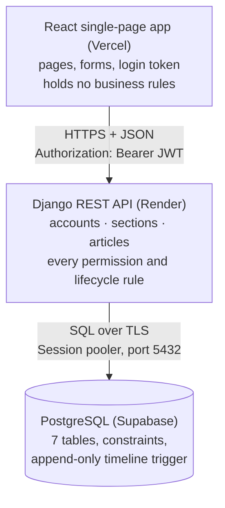

# Architecture

> First written at the end of Day 1 (Phase 1). Updated at the end of Phase 6, after deploying.

- **Live site:** https://editorial-workflow-inky.vercel.app
- **API:** https://editorial-api-1lb1.onrender.com (its health check is `/api/health/`; the bare address shows "Not Found", because everything lives under `/api/`)

## The moving pieces and how they talk to each other

There are three pieces, and only the middle one makes decisions.

- **React app (frontend):** shows pages and sends requests. It hides buttons a user can't use, but only to keep the screen clean. It never decides what is allowed, and after every action it reloads the data from the server instead of guessing the new state (Decision 24).
- **Django REST API (backend):** checks who the user is (JWT), what they may see and do, and every business rule. It is split into three apps:
  - `accounts`: users, roles, login;
  - `sections`: sections and writer assignments;
  - `articles`: articles, revisions, timeline, search, bulk actions, CSV, dashboard, alerts.
- **PostgreSQL (database):** stores everything, and enforces the rules that must hold even if the API had a bug: unique emails and section names, a Scheduled article must have a time, one open revision per article, and a trigger that blocks any change to the timeline (see schema.md).

The browser and the API are on different domains, so the API lists the site in `CORS_ALLOWED_ORIGINS`; otherwise the browser would block every response.

## Where the main rules live

Each rule is written once, in one file, and every endpoint that needs it calls that file.

| File | What it decides | Used by |
|---|---|---|
| `sections/access.py` | `visible_sections(user)`: editors see every section, writers only the ones they are assigned to | Section pages, and article visibility below |
| `articles/access.py` | `visible_articles(user)`: editors see everything; writers see articles in active sections they are assigned to. `CanEditArticle` / `CanEditRevision`: a writer edits only their own | Every article query: list, open, timeline, comments, bulk, CSV, dashboard, alerts. Anything outside it is a 404 |
| `articles/lifecycle.py` | The state machine (`TRANSITIONS`): which moves exist, from which statuses, and who may make them (author submits, a *different* editor approves, editors schedule, publish and unpublish). Also creating articles, editing (back to In Review after approval), revisions, comments. `_set_status()` is the only code that writes a status, and it always writes the timeline entry in the same transaction | Single moves, bulk actions, `publish_due`, `seed_demo` |
| `articles/listing.py` | Search, filters, sorting and pages. It only adds conditions to a query that starts from `visible_articles(user)`, so search can never reach an article the user can't see | `GET /api/articles/` |
| `articles/bulk.py` | Bulk schedule and unpublish: each article goes through `transition()` in its own transaction, so one refusal doesn't stop the others; the result lists every article | `POST /api/articles/bulk/` |
| `articles/calendar_export.py`, `dashboard.py`, `alerts.py` | The CSV, the dashboard numbers (counted in the database, IST weeks) and overdue alerts (worked out on each request) | Their own endpoints |

The views in `views.py` are thin: they read the request, call one of these functions, and turn the result into JSON. Refusals are raised as DRF exceptions, so every error reaches the browser as `{"detail": "..."}` with 400, 403 or 404, and the page shows that message as it is.

## Request path for one user action, end to end

**Logging in** happens once: the login page sends `POST /api/auth/login/`; Django checks the password against its stored hash and returns a signed JWT and the user's profile. React keeps the token in `localStorage`, and `api.js` adds it to every later request as `Authorization: Bearer <token>`.

**An editor clicks "Approve" on an article:**

1. `LifecycleActions.jsx` sends `POST /api/articles/42/approve/` through the shared axios client in `api.js`, which adds the token. The base address comes from `VITE_API_URL`, built into the site by Vercel.
2. Because the request goes to another domain with an `Authorization` header, the browser first sends an `OPTIONS` "preflight". `django-cors-headers` answers it only for origins in `CORS_ALLOWED_ORIGINS`.
3. On Render, gunicorn passes the request to Django. `config/urls.py` and the router in `articles/urls.py` send it to `ArticleViewSet.approve`.
4. `JWTAuthentication` checks the token's signature and expiry and loads the user. No token, or an expired one, gives 401.
5. `get_object()` looks the article up inside `visible_articles(user)`. An article this user can't see gives 404, the same as one that doesn't exist.
6. `lifecycle.transition(article, "approve", user)` opens a transaction and re-reads the article with `SELECT ... FOR UPDATE`, so two editors clicking at the same moment are handled one after the other. Then it checks:
   - who: approving is for an editor who is *not* the author. Otherwise 403, "You cannot approve an article you wrote. Another editor must approve it.";
   - the current status: only In Review can be approved. Otherwise 400 with the reason.
7. `_set_status()` saves the new status and inserts an `ArticleEvent` (from, to, who, their role at the time) in the same transaction. PostgreSQL checks the constraints and commits both rows together, or neither. The timeline trigger allows the INSERT; it only blocks UPDATE, DELETE and TRUNCATE.
8. The view returns the article as JSON. The page then reloads the article, its revisions and its timeline, and refreshes the alerts badge, so what the editor sees always comes from the database.

## Where each piece runs

| Piece | Runs on | Notes |
|---|---|---|
| React app | Vercel (free) | Root Directory `frontend`; Vite build. `vercel.json` sends every path to `index.html`, so reloading `/articles/42` works |
| Django API | Render (free web service) | Root Directory `backend`, build `bash build.sh`, start `gunicorn config.wsgi:application`, health check `/api/health/`. Sleeps after about 15 minutes without requests; the first request after that takes up to a minute |
| PostgreSQL | Supabase (free), Mumbai region | Reached through the Session pooler connection string (port 5432), over SSL |
| Local development | My laptop | Django on port 8000, Vite on port 5173, local PostgreSQL |

## Deployment setup

**How a deploy works.** Both Render and Vercel are connected to the GitHub repository and rebuild when `main` changes.
- Render runs `backend/build.sh`, which stops at the first error (`set -o errexit`). It installs the packages, collects the admin's static files (served by WhiteNoise from gunicorn), runs `migrate`, and runs `seed_demo --skip-if-exists` when `SEED_DEMO=True`. Migrations run during the build because Render's free plan has no shell.
- Vercel runs `npm run build` in `frontend/` with `VITE_API_URL` set, and serves the files.

**Settings come only from environment variables**, never from the repository (`backend/.env.example` lists them):

| Where | Variable | Purpose |
|---|---|---|
| Render | `PYTHON_VERSION` | 3.12.7, the version I test with |
| Render | `DJANGO_SECRET_KEY` | Signs the login tokens. On Render the app refuses to start if it is missing, instead of using the development key that is in the repository |
| Render | `DJANGO_DEBUG` | `False`: no error pages with code details, and the API answers in JSON only |
| Render | `DATABASE_URL`, `DATABASE_SSL_REQUIRE` | The Supabase Session pooler address, with SSL required |
| Render | `SEED_DEMO` | `True` creates the demo data on the first deploy; later deploys skip it |
| Render | `CORS_ALLOWED_ORIGINS` | The Vercel address, so the browser accepts the API's responses |
| Render | `CSRF_TRUSTED_ORIGINS` | Set to the same address, but the site doesn't need it: it sends tokens, not cookies, so CSRF checks never apply to it |
| Vercel | `VITE_API_URL` | The Render address, built into the site |

Render's own address is added to `ALLOWED_HOSTS` automatically from `RENDER_EXTERNAL_HOSTNAME`.

**Logs.** Errors go to the console, which is Render's Logs tab. Refused requests (401, 403, 404) are normal behaviour, so only real server errors (5xx) are logged.

## What I decided not to build, and why

- **Password reset, sign-up and email notifications:** not in the 10 goals. Demo accounts are created by the `seed_demo` command.
- **Rich-text editor:** article bodies are plain text. Formatting adds a lot of work and no required behaviour.
- **Real-time updates (WebSockets):** pages reload data after each action, and the alerts badge refreshes every minute, which is enough for a small editing desk.
- **Roles beyond Editor and Writer, or per-section roles:** the brief needs exactly two global roles plus section assignments.
- **Deleting sections or articles:** sections are archived, never deleted, and articles with history cannot be deleted at all, so the trail stays complete.
- **Editing articles through the Django admin:** deliberately left out so that every change goes through the API's rules and the timeline.
- **A background scheduler:** the free plan has no worker. `publish_due` is ready to be run by one; until then the overdue alerts show what didn't go out.
