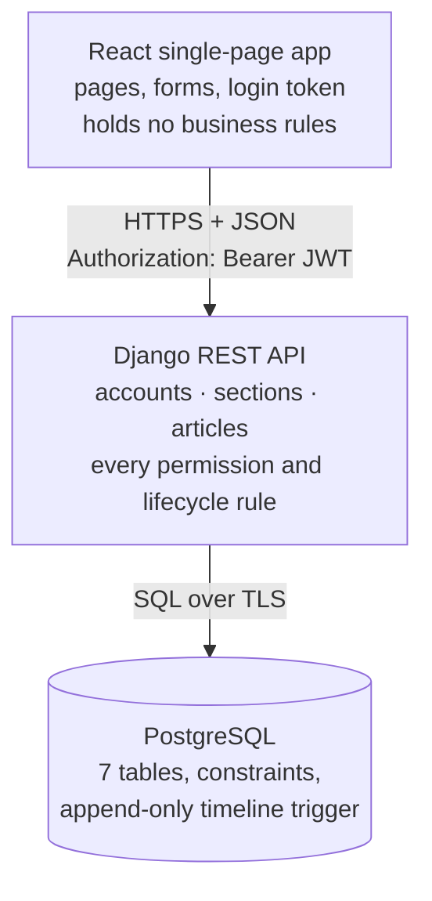

# Architecture

> Written at the end of Day 1 (Phase 1, the foundation). I will update it as features are added.

## The moving pieces and how they talk to each other

There are three pieces, and only the middle one makes decisions.

- **React app (frontend):** shows pages and sends requests. It hides editor-only buttons from writers, but only for convenience. It never decides what is allowed.
- **Django REST API (backend):** checks who the user is (JWT), what their role allows, and every business rule. It is split into three apps:
  - `accounts`: users, roles, login;
  - `sections`: sections and writer assignments;
  - `articles`: articles, revisions, timeline, alerts.
- **PostgreSQL (database):** stores everything. It also enforces the rules that must never break, even if the API had a bug: unique emails and section names, a Scheduled article must have a time, one open revision per article, and a trigger that blocks any edit or delete of timeline events.

## Where each piece runs

| Piece | Runs on | Notes |
|---|---|---|
| React app | Vercel (free) | Static build from `frontend/`; `vercel.json` sends every path to `index.html` |
| Django API | Render (free web service) | Built with `backend/build.sh`, served by `gunicorn config.wsgi`; sleeps after inactivity |
| PostgreSQL | Supabase (free) | Reached through the Session pooler connection string |
| Local development | My laptop | Django on port 8000, Vite on port 5173, local Postgres |

All secrets (database URL, Django secret key, allowed hosts, CORS origins) come from environment variables. `.env` files are git-ignored.

## Request path for one user action, end to end

At the end of Day 1 the main working action is **logging in and calling a protected endpoint**:

1. The user enters email and password on the React login page.
2. React sends `POST /api/auth/login/` with the email and password.
3. Django lower-cases the email, loads the user from Postgres, and checks the password against its stored PBKDF2 hash.
4. If it matches, Django signs a JWT and returns the access token, the refresh token and the user's profile (name, role).
5. React stores the token in `localStorage` and keeps the user in memory, so the page shows their name and role.
6. On every later request, React sends the token in the `Authorization` header, for example `GET /api/auth/writers/`.
7. Django verifies the token's signature, loads the user, and runs the permission check. `IsEditor` allows editors and returns 403 to writers.
8. The response goes back to React, which displays the data or the error message.

A page refresh calls `GET /api/auth/me/` with the stored token to restore the logged-in user.

## What I decided not to build, and why

- **Password reset, sign-up and email notifications:** not in the 10 goals. Demo accounts are created by an admin.
- **Rich-text editor:** article bodies are plain text. Formatting adds a lot of work and no required behaviour.
- **Real-time updates (WebSockets):** pages reload data after each action, which is enough for a small editing desk.
- **Roles beyond Editor and Writer, or per-section roles:** the brief needs exactly two global roles plus section assignments.
- **Deleting sections or articles:** sections are archived, never deleted, and articles with history cannot be deleted at all, so the trail stays complete.
- **Editing articles through the Django admin:** deliberately left out so that every change goes through the API's rules and the timeline.
