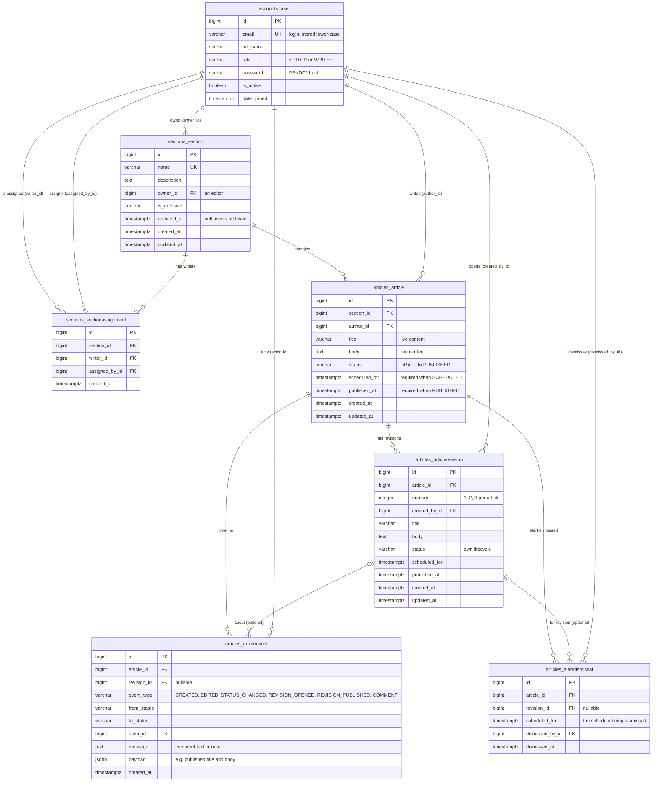

# Schema

## Tables and columns

Seven tables, in three Django apps. The ER diagram at the end shows every column and its type.

| Table | What one row is |
|---|---|
| `accounts_user` | A person who can log in, with a role: EDITOR or WRITER |
| `sections_section` | A section such as Politics, owned by one editor; archived, never deleted |
| `sections_sectionassignment` | "This writer may write in this section", with who assigned them and when |
| `articles_article` | An article. Its title and body are always the live text |
| `articles_articlerevision` | A change to a published article, with its own status, until it is published |
| `articles_articleevent` | One timeline entry: created, edited, status change, revision opened or published, or a comment. Insert-only |
| `articles_alertdismissal` | An editor dismissed the overdue alert for one specific scheduled time |

`Status` (DRAFT, IN_REVIEW, APPROVED, SCHEDULED, PUBLISHED) is a text column, not a table. Articles and revisions share the same columns through an abstract base class, `PublishableContent`, so one lifecycle function can move either of them.

## One-to-many and many-to-many relationships

**Many-to-many: writers and sections.** A writer can be in several sections and a section has several writers. The link is an explicit table, `sections_sectionassignment`, instead of a hidden Django join table, because I also store who made the assignment and when. `(section_id, writer_id)` is unique, so the same writer can't be assigned twice.

**One-to-many:**
- user → sections they own (`owner_id`): every section has one responsible editor.
- section → articles: an article belongs to exactly one section.
- user → articles they wrote (`author_id`): always the person who created it (Decision 18).
- article → revisions: numbered 1, 2, 3 per article; at most one is not yet published.
- user → revisions they opened (`created_by_id`).
- article → timeline events: the whole history of one article.
- revision → timeline events (optional, `revision_id` can be null): set when the event is about a revision, so the timeline can say "revision 2 was approved".
- user → events they caused (`actor_id`): every entry names a real person.
- article → alert dismissals, optionally for one revision, with the editor who dismissed it.

Roles are a column on the user, not a relationship: there are exactly two global roles, and the per-section part is the assignments table.

## Database rules versus application rules

**The database enforces facts that must be true for every row, whoever writes it.** These hold even if the API had a bug, or someone used the Django shell or raw SQL:
- unique emails, unique section names (exact match), one assignment per writer per section;
- a Scheduled article or revision has a publish time; a Published article has a published time (CHECK constraints);
- revision numbers are unique per article, and at most one revision per article is open (a partial unique index);
- the timeline can't be changed or deleted (a trigger);
- one dismissal per article, revision and scheduled time;
- foreign keys are created without `ON DELETE` in the database, so PostgreSQL refuses to delete a user, section or article that other rows still point to.

**The application enforces rules that depend on who is asking, on the current time, or on the path between states.** These live in a few Python files (see architecture.md):
- who can see which sections and articles (`sections/access.py`, `articles/access.py`);
- which lifecycle moves exist and who can make them: only the author submits, only a *different* editor approves, only editors schedule, publish and unpublish (`lifecycle.py`);
- a writer can create articles only in sections they are assigned to, and nothing can be created in an archived section;
- a scheduled time must be in the future. This can't be a CHECK constraint, because PostgreSQL requires CHECK constraints to give the same answer every time, and "now" changes;
- editing an Approved or Scheduled article sends it back to In Review;
- section names are unique ignoring capitals ("Tech" vs "tech"). The serializer checks this; the database only checks the exact match, as a backstop for two requests at the same moment.

The database does not know the lifecycle order: a raw SQL UPDATE could move a Draft straight to Published if it also set `published_at`. I accepted that, because every write in the app goes through `transition()`, which also writes the timeline entry in the same transaction. Putting the state machine in a trigger would have meant writing the rules twice, once in SQL and once in Python for the error messages.

## What I denormalised

- **The published text is copied into the timeline.** When an article or revision is published, the event's `payload` stores the exact title and body that went live. When a revision replaces the live text, the event also stores the previous title and body. This duplicates the article's text on purpose: the article row changes later, and the timeline is the one place that can't (Decision 7).
- **The actor's role is copied into each status-change event** (`payload.actor_role`). If someone's role changes later, the timeline still shows what they were when they acted.
- **`AlertDismissal.scheduled_for` copies the article's scheduled time** at the moment of dismissal. That copy is what makes the alert come back after a reschedule (Decision 10).
- **`scheduled_for` and `published_at` on the article** could be worked out from the timeline, but the list, the calendar, the dashboard and the alerts all filter and sort on them, so they are columns with indexes.

Things I chose *not* to store: dashboard counts and an "overdue" flag. Both are worked out in the database on each request (Decisions 30 and 31), so they can't go stale.

## What would break first at 100x the data

The demo has 40 articles. At 100x a real newsroom's volume, say a few hundred thousand articles and a few million timeline entries, this is the order I expect problems in:

1. **Search with a common word.** The GIN index finds matching articles quickly, but ranking them (`SearchRank`) recomputes the search vector from the title and body of *every* match before the top 20 can be picked. A word that matches 50,000 articles makes every search page do 50,000 of those. Fix: store the vector in a generated column with the GIN index on it, so ranking reads it instead of recomputing it.
2. **The total count on every page.** Each page of the article list runs a `COUNT(*)` for "Showing 21–40 of N", and a late page uses `OFFSET`, which reads and throws away every row before it. Fine at thousands, slow at hundreds of thousands. Fix: an estimated count above a limit, and keyset pagination ("after this id") for deep pages.
3. **The calendar CSV.** It exports every Scheduled and Published article ever, built in memory as one response. That grows without limit and would hit the memory and time limits of a small server first. Fix: a date range and a streaming response.
4. **Sorting by publish time.** The sort uses `COALESCE(published_at, scheduled_for)`, which none of the indexes cover, so PostgreSQL has to sort all matching rows. Fix: an index on that expression.
5. **The timeline table grows fastest**, because every publish copies the full body into it. It is only ever read per article, through the `(article_id, created_at)` index, so reads stay fast; the cost is disk space. Fix, much later: partition it by date.

One small thing I found while writing this: `articles_article` has two identical indexes on `author_id`, the one Django adds for every foreign key and one I listed in `Meta.indexes`. The second does nothing except slow down writes slightly; it should be removed in a migration.

## Database ER diagram

All seven tables live in PostgreSQL. Names are the real table names Django creates. `PK` = primary key, `FK` = foreign key, `UK` = unique.

`accounts_user` also has Django's standard auth columns (`last_login`, `is_staff`, `is_superuser`, `first_name`, `last_name`), left out of the diagram for clarity.

**Rules enforced by the database itself**

| Table | Rule | Why it exists |
|---|---|---|
| `accounts_user` | `email` is unique | Email is the login, so two accounts can't share one |
| `sections_section` | `name` is unique | Two sections with the same name would confuse everyone (the app also checks ignoring capitals) |
| `sections_sectionassignment` | `(section_id, writer_id)` is unique (`unique_writer_per_section`) | A writer is assigned to a section only once, even if two editors click at the same moment |
| `articles_article` | CHECK `article_scheduled_needs_time`: a SCHEDULED article has `scheduled_for` | A scheduled article must know when it goes out, or the alerts and calendar can't work |
| `articles_article` | CHECK `article_published_needs_time`: a PUBLISHED article has `published_at` | The dashboard and calendar count published articles by this time |
| `articles_articlerevision` | `(article_id, number)` is unique (`unique_revision_number`) | "Revision 2" means one thing per article |
| `articles_articlerevision` | Partial unique index `one_open_revision_per_article`: one row per article `WHERE status <> 'PUBLISHED'` | Two revisions in progress at once would overwrite each other when published. The app checks first for a clear message; this catches two people opening one at the same moment |
| `articles_articlerevision` | CHECK `revision_scheduled_needs_time`, and `number >= 0` | Same as for articles |
| `articles_articleevent` | Triggers `articles_event_no_update_delete` (BEFORE UPDATE OR DELETE, each row) and `articles_event_no_truncate` (BEFORE TRUNCATE) both call `articles_event_is_immutable()`, which raises an error | Goal 9: nobody, not even an editor, can rewrite history. Only the database sees every write, including `QuerySet.update()`, raw SQL and the admin (migration 0002, Decision 9) |
| `articles_alertdismissal` | `(article_id, revision_id, scheduled_for)` is unique with `NULLS NOT DISTINCT` (`one_dismissal_per_schedule`) | One dismissal per schedule. Without `NULLS NOT DISTINCT`, PostgreSQL treats every NULL `revision_id` as different, so an article's alert could be dismissed twice |
| All foreign keys | Created without `ON DELETE`, so PostgreSQL refuses to delete a row that others point to | An article with timeline entries, or a user who acted in one, can never disappear. Django adds `on_delete=PROTECT` for a clear error; only assignments and dismissals are deleted with their parent (by Django) |

**Indexes**

Every foreign key also gets a plain index from Django. The others, and what uses them:

| Table | Index | Used by |
|---|---|---|
| `articles_article` | `article_search_idx`, GIN on `setweight(to_tsvector('english', title), 'A') \|\| setweight(to_tsvector('english', body), 'B')` | Full-text search on the Articles page (migration 0003). The search uses exactly the same expression, so PostgreSQL can use the index (checked with `EXPLAIN`, Decision 26) |
| `articles_article` | `status` | Status filter, dashboard headline counts |
| `articles_article` | `(section_id, status)` | A section's articles filtered by status; dashboard "by section" |
| `articles_article` | `updated_at` | The default sort, newest first |
| `articles_article` | `scheduled_for` | Overdue alerts (`status = SCHEDULED AND scheduled_for < now`) |
| `articles_article` | `published_at` | Dashboard "published this week" and the 8-week chart |
| `articles_article` | `author_id` | "My articles". This duplicates the foreign-key index (see "What would break first") |
| `articles_articleevent` | `(article_id, created_at)` | Loading one article's timeline in order |
| `sections_sectionassignment`, `articles_articlerevision`, `articles_alertdismissal` | The unique indexes above | They also make "is this writer assigned here?", "this article's revisions" and "is this alert dismissed?" fast lookups |
